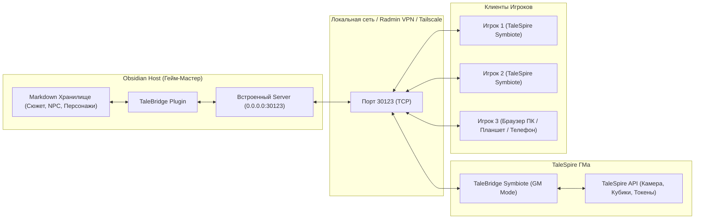

# TaleBridge: Obsidian + TaleSpire Integration

**TaleBridge** — это мощная связка **Obsidian** (база знаний, кампания, статблоки, сюжет) и **TaleSpire** (3D виртуальный игровой стол), построенная на официальных API без инжектов памяти и сторонних хаков.

Проект состоит из двух компонентов:
1. **TaleBridge Obsidian Plugin** — серверная часть внутри Obsidian (WebSocket/HTTP сервер на порту `30123`, автопарсинг статблоков и синхронизация Markdown-заметок).
2. **TaleBridge Symbiote** — клиентское приложение (React 19 + TypeScript + Tailwind CSS) внутри TaleSpire Chromium WebView, а также доступное в обычном веб-браузере для игроков.

---

## Ключевые возможности

### Для Гейм-Мастера (GM Mode)
- **Сюжетный трекер (Story Tracker)**: дерево сцен, зацепки комнат, скрытые подсказки («Пинок Мастера») и автоматический перелет камеры TaleSpire к нужным 3D-координатам в один клик.
- **Боевой трекер (Combat Tracker)**: очередь ходов, честный бросок инициативы для участников, полоски здоровья, быстрый урон и наложение состояний D&D 5e с передачей штрафов на экраны игроков.
- **Умный Бестиарий (Smart Roster)**: моментальный просмотр статблоков монстров и NPC прямо в игре, броски атак и заклинаний в лоток TaleSpire.
- **Кинотеатр медиа-вещания (Media Handout Showcase)**: показ артов, карт, древних свитков и атмосферных видеокатсцен игрокам в один клик с оверлеем Cinema Mode.
- **Приватный режим бросков (GM Secret Rolls)**: мгновенное переключение между открытыми и скрытыми бросками Мастера в TaleSpire.

### Для Игроков (Player Cockpit)
- **Полноценный лист персонажа D&D 5e**: характеристики, спасброски, Класс Доспеха, скорость, здоровье и редактирование параметров (раса, класс, уровень, макс. ХП) прямо из симбиота.
- **18 Классических навыков D&D 5e**: сворачиваемый аккордеон с фильтрами по характеристикам, поиском и сменой владений в 1 клик (Владение / Экспертиза).
- **Спасброски от смерти (Death Saves)**: интерактивный блок с честным считыванием бросков d20 из 3D-лотка TaleSpire.
- **Книга заклинаний и расходуемые ресурсы**: трекер ячеек 1-9 круга, костей хитов, вдохновения, короткого и длинного отдыха.
- **Интерактивный инвентарь**: учет предметов, веса, экипировки и автосохранение в Obsidian.
- **Личный блокнот (Журнал)**: встроенный Markdown-редактор с защитой от подглядывания другими игроками.
- **Архив улик**: постоянный доступ ко всем полученным от Мастера раздаточным материалам.

---

## Архитектура системы



---

## Быстрый старт

### Документация и инструкции по подключению:
- **[Руководство для Гейм-Мастера (docs/GM_GUIDE.md)](docs/GM_GUIDE.md)** — установка плагина, настройка сети, открытие портов, запуск TaleSpire и ведение игры.
- **[Руководство для Игрока (docs/PLAYER_GUIDE.md)](docs/PLAYER_GUIDE.md)** — как подключиться к серверу Мастера через TaleSpire или браузер, и как управлять листом персонажа.

---

## Разработка и сборка

### Требования:
- Node.js 18+ (рекомендуется 20+)
- npm

### Сборка симбиота:
```bash
cd symbiote
npm install
npm run build
```
Готовая сборка будет находиться в папке `symbiote/dist/`.

### Структура проекта:
```
TaleBridge/
├── obsidian-plugin/        # Плагин для Obsidian (Node.js WebSocket/HTTP Server)
│   ├── main.js
│   ├── manifest.json
│   └── styles.css
├── symbiote/               # React-клиент для TaleSpire (FSD Архитектура)
│   ├── src/
│   │   ├── app/            # Инициализация, стили, масштабирование
│   │   ├── pages/          # GmScreen, PlayerScreen
│   │   ├── widgets/        # PlayerCockpit, StoryTracker, CharacterRoster, CombatTracker
│   │   ├── features/       # Спасброски, инвентарь, заклинания, подключение, навыки
│   │   ├── entities/       # Карточки персонажей, атак, состояний
│   │   └── shared/         # WebSocket-мост, TaleSpire Driver, типы, хранилища Zustand
│   ├── dist/               # Скомпилированный продакшн-билд
│   └── package.json
├── docs/                   # Руководства для ГМа и игроков
│   ├── GM_GUIDE.md
│   └── PLAYER_GUIDE.md
└── README.md
```

---

## Лицензия

MIT License.
